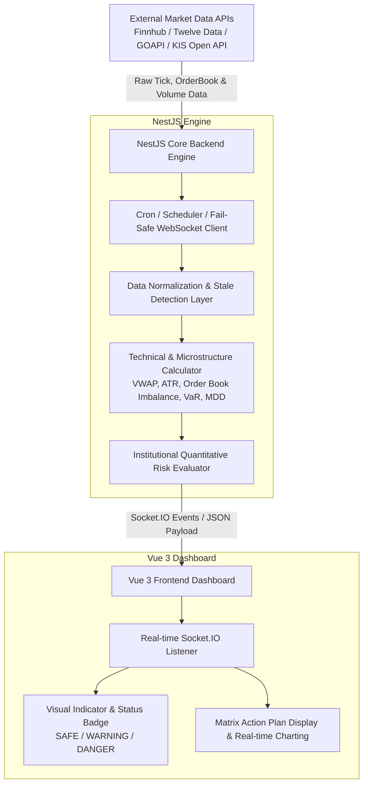

# Product Requirement Document \[Stokify]

## Spesifikasi Sistem Monitoring Pasar & Manajemen Risiko (Real-Time Engine)

**Versi:** 2.0 (Enterprise / Institutional Grade)\
**Status:** Perencanaan Arsitektur & Spesifikasi Teknikal

***

### 1. Pendahuluan

Dokumen ini berisi spesifikasi arsitektur, alur data, aturan manajemen risiko kuantitatif (_rule-based engine_), serta rencana sistem pemantauan harga pasar modal secara _real-time_ berbasis **NestJS**, **Vue 3**, dan **Socket.IO**.

Sistem dirancang untuk beroperasi secara mandiri di latar belakang (_background service_), mendeteksi anomali pergerakan harga pada bursa **IDX (Indonesia)**, **KOSPI**, dan **KOSDAQ (Korea Selatan)**, serta memberikan rekomendasi tindakan manajemen risiko secara otomatis tanpa ketergantungan pada model AI/LLM untuk pemrosesan angka.

***

### 2. Arsitektur Sistem



#### Ringkasan Alur Data:

1. **Data Ingestion:** NestJS terhubung ke Data Stream API eksternal secara terinterupsi (_fail-safe connection_).
2. **Processing & Risk Analysis:** Data mentah dihitung secara kuantitatif (ATR, VWAP, Order Imbalance) lalu dievaluasi oleh _Rule Engine_.
3. **Broadcasting:** Hasil evaluasi dikirim secara instant (_sub-millisecond_) ke Vue 3 via Socket.IO Gateway.

***

### 3. Komponen Utama & Spesifikasi Teknis

#### 3.1 Backend Engine (NestJS)

* **Framework:** NestJS (Node.js / TypeScript)
* **Modul Utama:**
  * `MarketDataModule`: Menangani koneksi persisten ke provider API eksternal (IDX, KOSPI, KOSDAQ) beserta fitur _fallback connection_.
  * `IndicatorModule`: Kalkulator indikator teknikal & mikrostruktur pasar (SMA, RSI, ATR, VWAP, StdDev).
  * `RiskEngineModule`: Evaluator berbasis aturan kuantitatif dinamis murni.
  * `GatewayModule`: Socket.IO Server Gateway untuk penyiaran (_broadcasting_) data ke frontend.
  * `FailSafeModule`: Monitoring kesehatan _data feed_ (_data freshness check_ & _circuit breaker_ internal).

#### 3.2 Real-time Communication (Socket.IO)

* Membuka koneksi persisten dua arah (_bidirectional_) antara NestJS dan Vue 3.
* Mengirimkan _payload_ terstruktur secara _real-time_ saat terjadi perubahan _tick_ atau saat aturan risiko terpicu.

#### 3.3 Frontend Dashboard (Vue 3)

* **Framework:** Vue 3 (Composition API / Script Setup) + Pinia (State Management).
* **Fungsi Utama:** Visualisasi metrik risiko secara _real-time_ tanpa perlu memuat ulang halaman (_zero refresh_).

***

### 4. Matriks Aturan Manajemen Risiko Kuantitatif (Institutional Ruleset Engine)

| ID Aturan   | Kriteria / Trigger Matematika                                       | Level Risiko                       | Tindakan / Rekomendasi Sistem                                         |
| ----------- | ------------------------------------------------------------------- | ---------------------------------- | --------------------------------------------------------------------- |
| **RULE-01** | `Price < (VWAP - 2 * ATR)` **DAN** `Volume > (2.5 * SMA_10_Volume)` | **DANGER** (Panic Selling)         | Eksekusi Sinyal Evakuasi / Pasang Stop Loss Ketat.                    |
| **RULE-02** | `Price Change <= ARB_Threshold` OR `Near Tick ARB`                  | **DANGER** (Liquidity Locked)      | Peringatan Likuiditas Terkunci; Dilarang menambah posisi.             |
| **RULE-03** | `Bid Volume / Ask Volume < 0.25` (Severe Order Imbalance)           | **DANGER** (Market Depth Collapse) | Sinyal Penurunan Ketebalan Beli; Bersiap exit sebelum harga terseret. |
| **RULE-04** | `Net Foreign Value < -100 Miliar IDR` (Khusus IDX)                  | **WARNING** (Foreign Outflow)      | Kurangi porsi posisi bertahap (_Gradual Exit_).                       |
| **RULE-05** | `KOSPI/KOSDAQ Index Drop > 2.5%` pada pembukaan sesi                | **WARNING** (Regional Spillover)   | Naikkan sensitivitas ambang batas risiko pada pasar domestik.         |
| **RULE-06** | `Drawdown dari Peak > 1.5 * Daily ATR`                              | **WARNING** (Volatility Expansion) | Lakukan _rebalancing_ porsi aset; perketat batas pemicu.              |
| **RULE-07** | `Data Stream Inactive > 30 Detik`                                   | **SYSTEM\_ALERT** (Data Stale)     | Peringatan Sistem: Feed data terputus, gunakan harga terakhir.        |
| **RULE-08** | Pergerakan harga dan volume berada dalam rentang wajar (≤ 1 ATR)    | **SAFE**                           | Tahan posisi (_Hold_) / Pantau kondisi pasar normal.                  |

***

### 5. Struktur Data Payload (TypeScript Interface)

```typescript
// Enums untuk Standar Bursa & Status Risiko
export type ExchangeType = 'IDX' | 'KOSPI' | 'KOSDAQ';
export type RiskLevel = 'SAFE' | 'WARNING' | 'DANGER' | 'SYSTEM_ALERT';

// Metadata Mikrostruktur & Indikator
export interface MarketMetrics {
  vwap: number;
  atr14: number;
  bidAskRatio: number;      // Bid Volume / Ask Volume
  currentDrawdown: number;  // Peak-to-Trough Drawdown (%)
}

// Payload Data Mentah dari Provider
export interface MarketTick {
  symbol: string;           // Contoh: 'BBRI.JK', '005930.KS'
  exchange: ExchangeType;
  currentPrice: number;
  openPrice: number;
  highPrice: number;
  lowPrice: number;
  changePercent: number;    // Persentase perubahan harian (e.g., -4.2)
  volume: number;
  avgVolume10d: number;
  foreignNetValue?: number; // Net buy/sell asing (IDR/KRW)
  metrics: MarketMetrics;
  timestamp: string;
}

// Result Evaluasi Risiko dari Engine
export interface RiskEvaluationResult {
  symbol: string;
  riskLevel: RiskLevel;
  triggeredRules: string[];
  recommendedAction: string;
  isDataStale: boolean;
  timestamp: string;
}
```

***

### 6. Contoh Implementasi Logika Backend (NestJS Service)

```typescript
import { Injectable } from '@nestjs/common';
import { MarketTick, RiskEvaluationResult, RiskLevel } from './interfaces/market.interface';

@Injectable()
export class RiskEngineService {
  evaluateRisk(tick: MarketTick): RiskEvaluationResult {
    const triggeredRules: string[] = [];
    let riskLevel: RiskLevel = 'SAFE';

    // 1. Cek Proteksi Data Stale (Fail-Safe Check)
    const tickTime = new Date(tick.timestamp).getTime();
    const now = new Date().getTime();
    const isDataStale = (now - tickTime) > 30000; // > 30 detik tanpa update

    if (isDataStale) {
      triggeredRules.push('RULE-07: DATA_STREAM_INACTIVE_STALE');
      riskLevel = 'SYSTEM_ALERT';
    }

    // 2. Rule 1: Dynamic Panic Selling (Harga di bawah VWAP - 2*ATR + Volume Spike)
    const panicThreshold = tick.metrics.vwap - (2 * tick.metrics.atr14);
    if (tick.currentPrice < panicThreshold && tick.volume > tick.avgVolume10d * 2.5) {
      triggeredRules.push('RULE-01: DYNAMIC_PANIC_SELLING_DETECTED');
      riskLevel = 'DANGER';
    }

    // 3. Rule 2: Mendekati Auto Rejection Bawah (ARB) / Limit Down
    const arbLimit = tick.exchange === 'IDX' ? -14.0 : -28.0; // IDX vs KOSPI/KOSDAQ Limit
    if (tick.changePercent <= arbLimit) {
      triggeredRules.push('RULE-02: ARB_LIQUIDITY_LOCKED');
      riskLevel = 'DANGER';
    }

    // 4. Rule 3: Market Depth Collapse (Order Imbalance)
    if (tick.metrics.bidAskRatio < 0.25) {
      triggeredRules.push('RULE-03: SEVERE_ORDER_IMBALANCE');
      if (riskLevel !== 'DANGER') riskLevel = 'DANGER';
    }

    // 5. Rule 4: Net Foreign Outflow Masif (Khusus IDX)
    if (tick.exchange === 'IDX' && tick.foreignNetValue && tick.foreignNetValue < -100_000_000_000) {
      triggeredRules.push('RULE-04: MASSIVE_FOREIGN_OUTFLOW');
      if (riskLevel !== 'DANGER') riskLevel = 'WARNING';
    }

    // Penentuan Rencana Aksi Kuantitatif
    let recommendedAction = 'Hold / Monitor Normal';
    if (riskLevel === 'SYSTEM_ALERT') {
      recommendedAction = 'PERINGATAN: Stream data terputus. Jangan eksekusi order berdasarkan harga stale.';
    } else if (riskLevel === 'WARNING') {
      recommendedAction = 'Kurangi porsi posisi bertahap. Perketat batas Stop Loss.';
    } else if (riskLevel === 'DANGER') {
      recommendedAction = 'Sinyal Evakuasi Modal: Pertimbangkan cut loss/exit segera.';
    }

    return {
      symbol: tick.symbol,
      riskLevel,
      triggeredRules,
      recommendedAction,
      isDataStale,
      timestamp: new Date().toISOString(),
    };
  }
}
```

***

### 7. Penanganan Regulasi Spesifik Bursa & Edge Cases

1. **Aturan Fraksi Harga (Tick Size - IDX):** Kalkulasi penetapan order dan pergeseran harga disesuaikan dengan fraksi harga resmi BEI (Rp1, Rp2, Rp5, Rp10, Rp25).
2. **Volatility Interruption (KOSPI / KOSDAQ):** Penanganan kondisi jeda transaksi sementara (_Static/Dynamic VI_) pada bursa KRX saat terjadi pergerakan ekstrem secara mendadak.
3. **Mekanisme Pre-Opening & Pre-Closing:** Penanganan _Gap Down_ saat pembukaan bursa dengan membaca indikasi _Indicative Equilibrium Price_ (IEP).

***

### 8. Tahapan Pengembangan Lanjutan

1. **Fase 1:** Setup Modul Integrasi API Data Pasar Multi-Exchange (IDX, KOSPI, KOSDAQ) & Fail-Safe Data Layer.
2. **Fase 2:** Pembangunan _Rule Engine_ Manajemen Risiko Dinamis (ATR, VWAP, Order Imbalance) di NestJS.
3. **Fase 3:** Integrasi Gateway Socket.IO untuk pemancaran data _real-time_.
4. **Fase 4:** Pembuatan Dashboard Monitoring Interaktif menggunakan Vue 3.
